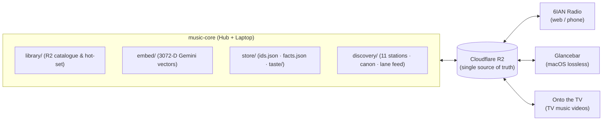

# music-core

The shared backend behind a personal multi-surface music system: a phone-first web radio ([6IAN](https://github.com/todd866/6ian-radio)), a macOS menu-bar lossless player ([Glancebar](https://github.com/todd866/glancebar)), and a living-room TV music-video player ([Onto the TV](https://github.com/todd866/onto-the-tv)).



## Design: one writer per store

Every surface reads the same Cloudflare R2 bucket (`music/` + `catalogue.json`) and never invents its own parallel database:

| Store | R2 path | Single writer | What it holds |
|---|---|---|---|
| **Catalogue** | `catalogue.json` | `library/musiclib.py` (nightly hub) | Every lossless master in the bucket, verified tags, duration, cover hashes |
| **Song IDs** | `music/ids.json` | `store/musicstore.py` (with catalogue build) | Canonical `sha256` ↔ `embed.match_key`, ISRC, path, Apple ID, YouTube ID, library persistent ID |
| **Embeddings** | `music/vectors/` + hub `vectors/` | `embed/embed.py` (Gemini Batch API, capped daily ledger) | 3072-D audio embeddings (`tracks.f32` + `tracks-index.jsonl`) and Glancebar `music-space.json` export |
| **Song facts** | `music/facts.json` | `store/facts.py` (resumable, paced) | Sourced original release year (MusicBrainz), LRCLIB lyrics ID, Wikipedia artist summary, cover keys |
| **Taste log** | `music/taste/<listener>/<YYYY-MM>/<app>-<host>.jsonl` | Each surface writes only its own append-only shard | Plays, finishes, skips, early-skips, likes, dislikes, hearts — deterministic SHA-1 event IDs |

## Layout

| Folder | Purpose |
|---|---|
| `store/` | Alias table builder, append-only taste log (`musicstore.py`), sourced facts builder (`facts.py`), cross-language `match-key-fixture.json` |
| `library/` | R2 bucket-truth catalogue (`musiclib.py`), lossless hot-set sync, download metadata verifier (`trackmeta.py`), `push.sh` |
| `embed/` | Resumable 3072-D Gemini audio embedding pipeline (`embed.py`, `nightly.sh`) with daily spend cap |
| `discovery/` | Public radio playlist scrapers (`radio.py`: KEXP, NTS, BBC 6 Music, WFMU, RRR, PBS, 4ZZZ, RTR, KCRW, Radio Paradise, Double J), canon & era back-catalogue (`backcatalogue.py`), public iTunes Search helpers (`itunes.py`), unified lane feeder (`scout.py`, `lane_feed.py`) |
| `media_sync/` | Shared signal ledger, TV channel scoring (`tv-scores`), and pipeline health checks (`media_sync.py`) |
| `pipeline/` | Chained hub nightly runner (`m2-nightly.sh`), placer wrapper (`m2-place.sh`), laptop sync (`m5-sync.sh`), and Fleet-compatible `.fleet/check` (`check.py`) |
| `launchd/examples/` | Parameterised macOS `launchd` templates (`REPLACE_HOME`) |
| `docs/config.example/` | Example per-host JSON configs |

No private acquisition or DRM-bypass tooling ships in this repository: see [docs/acquisition.md](docs/acquisition.md).

## Quick start

1. Install Python 3.11+, `rclone`, and `ffmpeg`.
2. Configure an `rclone` remote for your private R2 (or S3-compatible) bucket and copy the templates in `docs/config.example/` into `~/.config/glancebar/` (adjusting paths and remote name).
3. Run the unit test suite (offline, no network, no audio):
   ```bash
   ./tests.sh
   ```
4. Optionally install the scheduled jobs from `launchd/examples/` (replacing `REPLACE_HOME` with your home directory).

## Licence

MIT. External metadata is queried politely from MusicBrainz (CC0), the public iTunes Search API, Wikipedia (CC BY-SA), LRCLIB, and public community-radio playlists respecting `robots.txt` and per-host rate limits.
